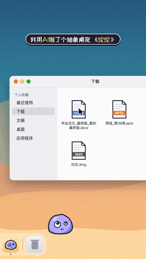

<p align="center"></p>

<h1 align="center">Tuotuo (坨坨)</h1>
<p align="center"><b>An absurdist macOS desktop pet that takes Chinese internet slang literally</b></p>

<p align="center">
  
  &nbsp;
  
</p>

[中文](README.md)

Tuotuo is a doodle-style jelly blob ("一坨", *a blob*) that lives on your Dock. Click it and it acts out a piece of Chinese internet slang *literally*: 摸鱼 ("touching fish", slacking off) turns it into a fish, 内卷 ("involution") rolls it into a swiss roll, 蚌埠住了 ("can't hold it", a pun on a clam) turns it into a laughing clam. There are 25 of them.

It also reverses the pet/owner relationship: leave your cursor on it and it pats *your cursor*; it throws a ball for *you* to fetch. Drag any file onto it and it tastes it (animation only, the file is untouched); files named "final version" get spat out. The quit button dodges you twice.

## Download

Grab `Tuotuo-1.0-mac.dmg` from [Releases](../../releases/latest). macOS 11+, Apple silicon and Intel.

The app is not notarized, so macOS blocks the first launch: open System Settings > Privacy & Security, scroll down and click "Open Anyway", or run

```bash
xattr -dr com.apple.quarantine /Applications/坨坨.app
```

## Privacy

Tuotuo reads only the cursor position, the frames of on-screen windows (not their titles or contents), the clock and the battery level. It needs no permissions, never reads the keyboard, never goes online and never touches your files. Idle CPU is about 6%.

## Build

```bash
cd app && ./build.sh                                          # app/build/坨坨.app, universal, ad-hoc signed
cd dist && dmgbuild -s dmg_settings.py "坨坨" Tuotuo-1.0-mac.dmg  # needs: pip install dmgbuild
python3 -m http.server 8000 -d web                            # browser dev mode with a fake desktop
```

The pet is plain HTML5 canvas (`web/pet.js`, one `def(...)` per slang act, lines in `web/lines.js`) hosted in a transparent full-screen `WKWebView` panel (`app/Sources/main.swift`) that only accepts the mouse where the pet is. `video/` holds the author's local pipeline for the promo video.

## License

Code: [MIT](LICENSE). Bundled font ZCOOL KuaiLe: [SIL OFL 1.1](web/OFL.txt).
