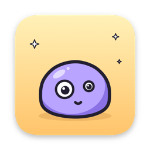
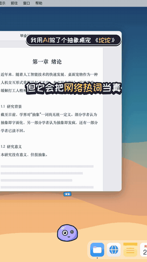
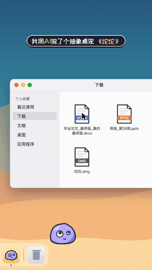
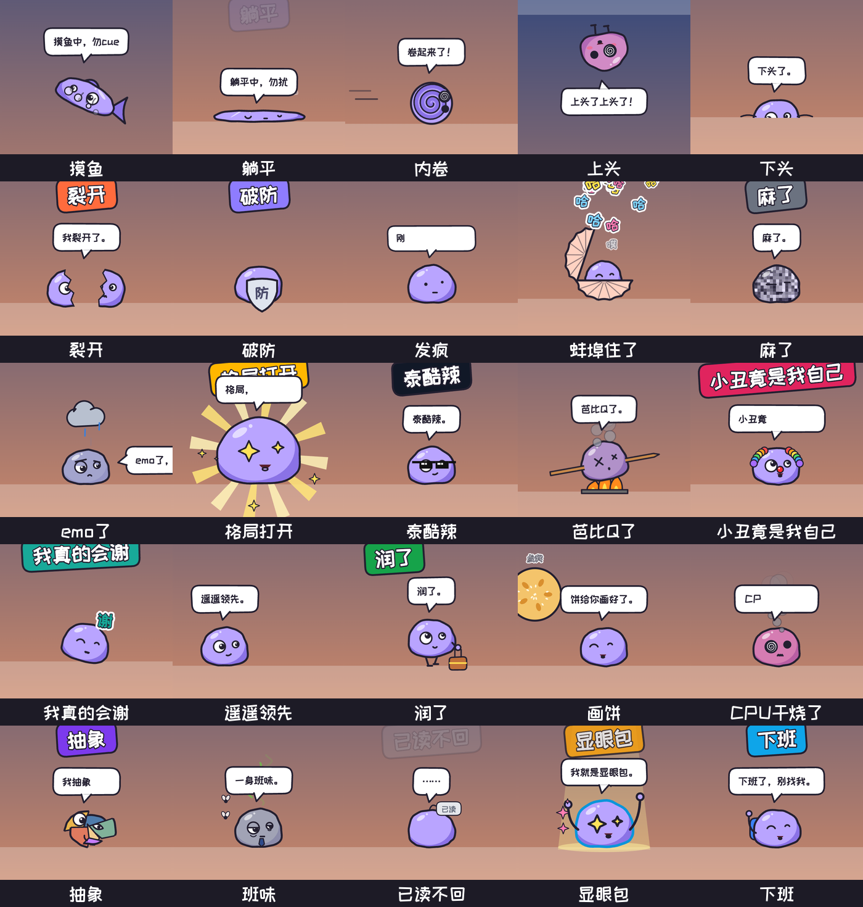

<p align="center"></p>

<h1 align="center">坨坨</h1>
<p align="center"><b>一只把网络热词当真的抽象桌宠 · macOS</b></p>
<p align="center">别人的桌宠是猫猫狗狗，我的桌宠是一坨。</p>

<p align="center">
  
  &nbsp;
  
</p>

[English](README.en.md)

## 下载

到 [Releases](../../releases/latest) 下载 `Tuotuo-1.0-mac.dmg`（2.3 MB），打开后把「坨坨」拖进「应用程序」。

- 系统要求：macOS 11 或更新，Apple 芯片和 Intel 都可以
- **第一次打开提示"无法验证开发者"？** 不是病毒，是没买苹果的开发者签名。打开 系统设置 > 隐私与安全性，往下拉，点「仍要打开」。或者在终端运行：
  ```bash
  xattr -dr com.apple.quarantine /Applications/坨坨.app
  ```

## 怎么玩

| 你做什么 | 它会怎样 |
|---|---|
| 点它一下 | 随机演一个网络热词的**字面意思**：摸鱼就变成鱼，内卷就卷成蛋卷 |
| 连点四下 | 满屏发疯，落地后说"刚才那个不是我" |
| 拖着它甩 | 它会飞出去、撞墙、摇匀了 |
| 鼠标停在它身上不动 | 它反过来伸手摸你的鼠标："乖，辛苦了" |
| 把任意文件拖到它身上 | 它帮你尝尝。文件名带"最终版"的，它不信，吐出来（只是动画，文件原地不动） |
| 等一会儿 | 它扔个球，让**你**去捡。捡到了："好狗狗！" |
| 右键 / 菜单栏图标 | 让它表演指定热词、换颜色、调大小、闭嘴三十分钟、静音 |
| 菜单栏 > 让它走… | "真的走"按钮会躲你两次，第三次它才拖着行李箱离开 |

它还会看时间：周五下午更爱摸鱼，工作日 18:00 准时下班，凌晨劝你睡觉，电量低于 20% 自动躺平。它会在 Dock 上散步，也会跳到窗口顶上坐着，你拖动窗口它就跟着走。

## 25 个热词



摸鱼 · 躺平 · 内卷 · 上头 · 下头 · 裂开 · 破防 · 发疯 · 蚌埠住了 · 麻了 · emo了 · 格局打开 · 泰酷辣 · 芭比Q了 · 小丑竟是我自己 · 我真的会谢 · 遥遥领先 · 润了 · 画饼 · CPU干烧了 · 抽象 · 班味 · 已读不回 · 显眼包 · 下班

想让它学会新的热词？欢迎提 Issue 点单，或者直接看下面的「加一个热词」。

## 它读什么，不做什么

- 只读：鼠标位置、屏幕上窗口的**边框位置**（不读窗口标题和内容）、时间、电量
- 不需要任何隐私权限，不读键盘，不联网，不删除也不修改任何文件
- 闲置时 CPU 占用约 6%，睡着时更低

## "抽象"是怎么设计的

纯随机不好笑，"有内在逻辑的不合理"才好笑。坨坨的每个行为都挂在一个梗上：字面化（摸鱼就真的变成鱼）、主宠反转（它把你当宠物）、一本正经地胡说（"检测到你在工作，建议停止"）、发癫（发完疯装没事）、丑萌低保真（会抖的手绘描边）。完整思路见 [DESIGN.md](DESIGN.md)。

## 从源码构建

需要 Xcode 命令行工具（`swiftc`）。

```bash
cd app && ./build.sh                  # -> app/build/坨坨.app（通用二进制，ad-hoc 签名）
```

打包 DMG（需要 `pip install dmgbuild`）：

```bash
cd dist && dmgbuild -s dmg_settings.py "坨坨" Tuotuo-1.0-mac.dmg
```

在浏览器里调试（带假桌面、可拖动的窗口和每个动作的按钮）：

```bash
python3 -m http.server 8000 -d web    # 打开 http://localhost:8000/
```

## 加一个热词

所有动作都在 [`web/pet.js`](web/pet.js) 的 `def(...)` 里，一个热词就是一个对象：

```js
def('moyu', {
  word: '摸鱼', col: '#2f9cf0', auto: true, click: true,   // 卡片文字和颜色；能否自动触发、能否被点出来
  start(p, a) { ... },            // 开始时：出声音、说话
  update(p, a, dt) { ... },       // 每帧：移动，返回 true 表示演完了
  pose(p, a, rs) { ... },         // 改身体：拉伸、换眼睛嘴巴、加道具
});
```

台词都在 [`web/lines.js`](web/lines.js)。改完在浏览器里点对应按钮就能看效果，`web/sheet.html?act=<id>` 可以逐帧截图检查。

## 项目结构

```
web/     桌宠本体：pet.js 行为引擎，sound.js 合成音效，lines.js 台词，host.js 和 Mac 外壳通信
app/     Mac 外壳：Swift + WKWebView，全屏透明窗口，只有鼠标在坨坨身上时才接收点击
dist/    DMG 打包配置、背景图、安装说明
video/   宣传片流水线：模拟桌面舞台（stage.js）逐帧录制，配合 TTS、AI 配乐和 DaVinci Resolve 剪辑
docs/    README 用到的图
```

`video/` 里的脚本是作者本机的制作流水线（写死了本地路径），放在这里供参考。

## 许可

代码使用 [MIT](LICENSE) 许可。内置字体 ZCOOL KuaiLe（站酷快乐体）使用 [SIL Open Font License 1.1](web/OFL.txt)。

它没用，但它很抽象。
